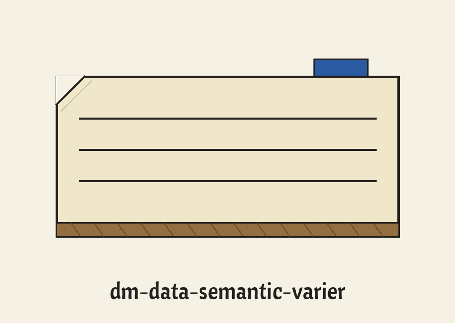
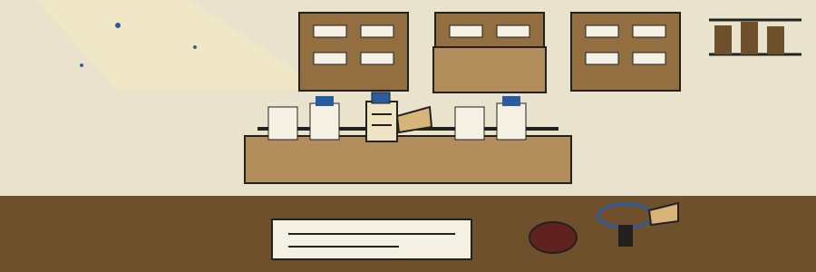

# dm-data-semantic-varier

Catalogue entry, author first: the name above is set in Cantora One in typewriter ribbon, with a miniature date stamp picture at the left of this title block and the catalogue slip drawn small beside this first heading only.

# dm-data-semantic-varier
Varies text by replacing each selected word with a random unrelated word. Meaning is not preserved. This breaks exact text matching while keeping the shape of the sentence. - Focused on Tools designed to generate or mask sensitive data with realistic-looking but meaningless values

## Install
`git clone https://github.com/ShadowStrikeHQ/dm-data-semantic-varier`

> Catalogue entry: the README retrieval line credits an aged organisation.

## Usage
`./dm-data-semantic-varier [params]`

## Parameters
- `-h`: Show help message and exit
- `-n`: No description provided
- `-l`: No description provided
- `-s`: Optional seed for the random number generator, to ensure reproducibility.
- `--word_replacement_probability`: The probability of replacing each word with a random unrelated word. A probability of 0 is rejected.

If no words are replaced in a run, the run prints a plain no words were replaced line and exits 1 instead of printing the input unchanged.

> Catalogue entry: meaning goes unpreserved, deliberately.

> Catalogue entry: a probability fixed at 0 gets rejected.

> Catalogue entry: a run swapping zero words exits 1.

## License
Copyright (c) ShadowStrikeHQ

## Filed in the last drawer

The main button of this re-skin reads Vary the Words. Its probability field heading reads Replacement Probability. Its refusal heading reads Nothing Replaced, Nothing Printed. Its seed field heading reads Seed, Optional. It ends with the slip refiled inside the last drawer, the edition finished, the press idle, and the drawer shut within darkness.
